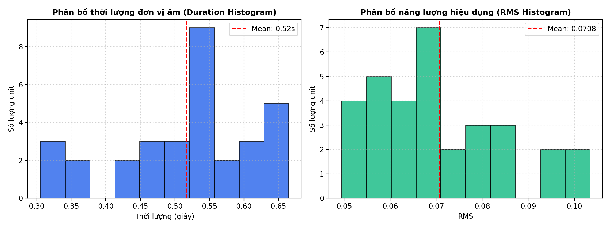
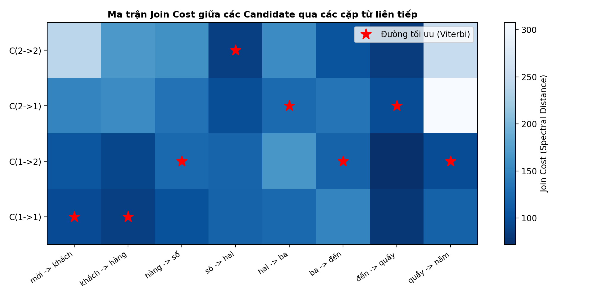
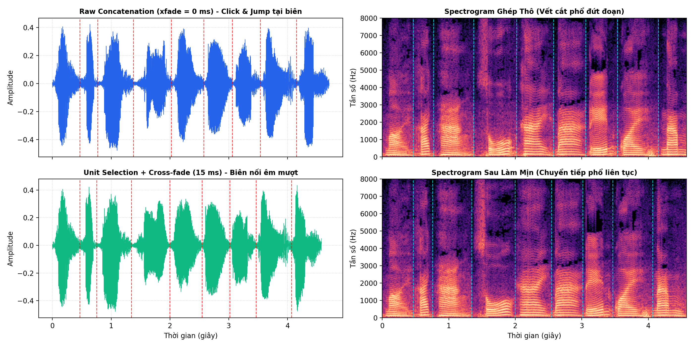
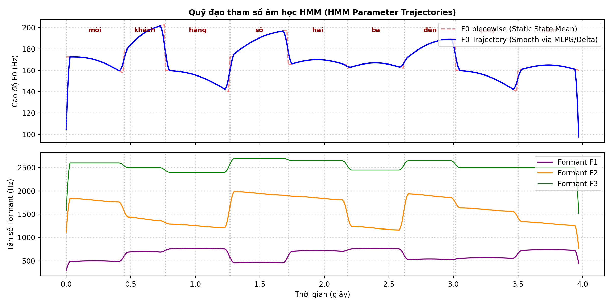
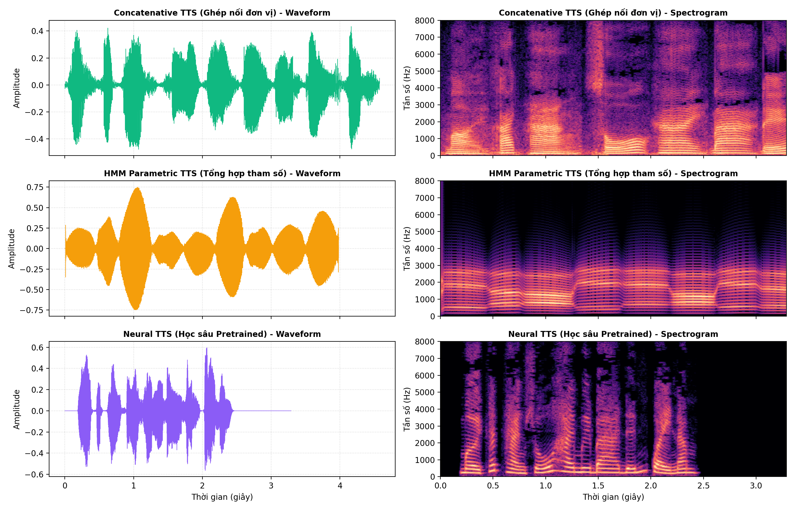

# TRƯỜNG ĐẠI HỌC THỦY LỢI
## KHOA CÔNG NGHỆ THÔNG TIN • BỘ MÔN TRÍ TUỆ NHÂN TẠO
---
### BÁO CÁO THỰC HÀNH LAB 4
# TỔNG HỢP TIẾNG NÓI (TEXT-TO-SPEECH - TTS)
### *Từ kiến trúc TTS, ghép nối và unit selection đến tổng hợp tham số HMM và TTS học sâu*

- **Môn học:** Xử lý âm thanh và tiếng nói (CSE457)
- **Sinh viên thực hiện:** Nguyễn Anh Minh
- **Mã sinh viên:** 2351260670
- **Lớp:** K65 - Công nghệ Thông tin / AI
- **Giảng viên hướng dẫn:** Bộ môn Trí tuệ Nhân tạo - ĐH Thủy Lợi

---

## MỤC LỤC
1. [Mục tiêu và Chuẩn đầu ra của Bài Lab](#1-mục-tiêu-và-chuẩn-đầu-ra-của-bài-lab)
2. [Cơ sở Lý thuyết và Công thức Toán học](#2-cơ-sở-lý-thuyết-và-công-thức-toán-học)
   - 2.1. Kiến trúc tổng quát hệ thống Text-to-Speech
   - 2.2. Text Normalization và biểu diễn âm vị học
   - 2.3. Mô hình Nguồn - Bộ lọc (Source-Filter Model)
   - 2.4. Phương pháp tổng hợp ghép nối và Unit Selection
   - 2.5. Làm mịn biên nối (Boundary Smoothing & Cross-fade)
   - 2.6. Tổng hợp tham số dựa trên HMM (HMM-based Parametric Synthesis)
   - 2.7. Tổng hợp tiếng nói học sâu (Neural TTS)
3. [Chuẩn bị Dữ liệu và Tiền xử lý Inventory](#3-chuẩn-bị-dữ-liệu-và-tiền-xử-lý-inventory)
   - 3.1. Thu thập và chuẩn hóa tập từ vựng miền hẹp
   - 3.2. Thuật toán cắt lọc khoảng lặng (Silence Trimming via Energy & ZCR)
   - 3.3. Thống kê đặc trưng tập đơn vị âm (Duration & RMS)
4. [Triển khai Thực nghiệm và Kết quả](#4-triển-khai-thực-nghiệm-và-kết-quả)
   - 4.1. Thực nghiệm 1: Baseline Concatenation và phân tích lỗi biên nối
   - 4.2. Thực nghiệm 2: Thuật toán Unit Selection bằng Quy hoạch động (Viterbi)
   - 4.3. Thực nghiệm 3: Khảo sát độ dài Cross-fade làm mịn biên
   - 4.4. Thực nghiệm 4: Phân tích Prosody và kiểm chứng mô hình Source-Filter
   - 4.5. Thực nghiệm 5: Mô phỏng tổng hợp HMM và quan sát Trajectory
   - 4.6. Thực nghiệm 6: Inference TTS học sâu và đo lường tài nguyên
5. [Đánh giá Chất lượng và So sánh 3 Hướng Tiếp cận](#5-đánh-giá-chất-lượng-và-so-sánh-3-hướng-tiếp-cận)
   - 5.1. Bảng so sánh kỹ thuật tổng hợp
   - 5.2. Kết quả đánh giá nghe chủ quan (Listening Test / MOS)
6. [Trả lời Chi tiết 10 Câu hỏi Báo cáo Lý thuyết](#6-trả-lời-chi-tiết-10-câu-hỏi-báo-cáo-lý-thuyết)
7. [Kết luận và Bài học Kinh nghiệm](#7-kết-luận-và-bài-học-kinh-nghiệm)

---

## 1. Mục tiêu và Chuẩn đầu ra của Bài Lab
- **Mục tiêu tổng quát:** Nối liền kiến thức nền tảng về xử lý tín hiệu số (FFT/STFT, bộ lọc, OLA), đặc trưng âm học ($F_0$, Formant, phổ Log-magnitude) và các mô hình học máy (HMM, Deep Learning) với bài toán sinh tín hiệu âm thanh tiếng nói (waveform).
- **Chuẩn đầu ra (SLOs):**
  1. Nắm vững và mô tả được luồng xử lý TTS hoàn chỉnh: *Văn bản $\to$ Chuẩn hóa $\to$ Phiên âm $\to$ Ngữ điệu (Prosody) $\to$ Backend tổng hợp $\to$ Sóng âm (Waveform)*.
  2. Xây dựng module chuẩn hóa câu (Text Normalization) cho miền ứng dụng hẹp "Thông báo xếp hàng tại quầy giao dịch".
  3. Cài đặt thành công thuật toán **Unit Selection** dựa trên hàm mục tiêu tối thiểu hóa tổng chi phí: **Target Cost** và **Join Cost** thông qua thuật toán quy hoạch động Viterbi.
  4. Thực hiện kỹ thuật làm mịn biên nối bằng **Cross-fade** và phân tích hiện tượng gián đoạn phổ (spectral discontinuity) trên Waveform và Spectrogram.
  5. Kiểm chứng mối liên hệ giữa tần số lấy mẫu $F_s$, chu kỳ cơ bản $N_p$ với tần số $F_0$; giải thích cơ chế độc lập giữa Nguồn kích thích và Bộ lọc thanh quản.
  6. Mô phỏng quá trình sinh quỹ đạo tham số âm học (parameter trajectory generation) của HMM có ràng buộc đặc trưng động ($\Delta, \Delta\Delta$).
  7. Chạy thực nghiệm mô hình TTS học sâu (Neural TTS), đo độ trễ (latency) và hệ số thời gian thực (Real-Time Factor - RTF).
  8. Thực hiện bài nghe đánh giá mù (MOS/Listening test) và so sánh toàn diện 3 thế hệ TTS.

---

## 2. Cơ sở Lý thuyết và Công thức Toán học

### 2.1. Kiến trúc tổng quát hệ thống Text-to-Speech
Một hệ thống TTS hoàn chỉnh gồm 2 phân hệ chính:
1. **Front-End (Phân tích ngôn ngữ & âm vị học):**
   $$\text{Text } T \xrightarrow{\text{Normalize}} \text{Words } W \xrightarrow{\text{G2P / Lexicon}} \text{Phones } P \xrightarrow{\text{Prosody}} \text{Acoustic Targets } \Theta$$
2. **Back-End (Bộ tổng hợp sóng âm - Speech Synthesizer):**
   Biến đổi biểu diễn âm vị/tham số thành sóng âm thanh tự nhiên $y[n]$.

```
+------------+     +---------------+     +--------------+     +-----------------+     +---------------+     +----------+
|  Văn bản   | --> |   Chuẩn hóa   | --> |   Phiên âm   | --> |     Ngữ điệu    | --> |  Bộ tổng hợp  | --> | Waveform |
|   (Text)   |     | (Normalizer)  |     | (G2P/Tokens) |     |  (F0, Duration) |     | (Synthesizer) |     |  y[n]    |
+------------+     +---------------+     +--------------+     +-----------------+     +---------------+     +----------+
```

### 2.2. Text Normalization và biểu diễn âm vị học
Trong bài toán miền hẹp, các chuỗi số viết tắt hoặc ký tự số cần được chuyển đổi sang chuỗi từ phát âm:
$$\text{"Mời khách hàng số 23 đến quầy 5."} \implies \text{['mời', 'khách', 'hàng', 'số', 'hai', 'ba', 'đến', 'quầy', 'năm']}$$

### 2.3. Mô hình Nguồn - Bộ lọc (Source-Filter Model)
Mô hình toán học của Rabiner & Schafer biểu diễn tín hiệu tiếng nói $X(z)$ trong miền Z:
$$X(z) = E(z) \cdot H(z) = E(z) \cdot \frac{B(z)}{A(z)} = E(z) \cdot \frac{b_0 + \sum_{k=1}^M b_k z^{-k}}{1 - \sum_{k=1}^P a_k z^{-k}}$$
- **Nguồn kích thích $E(z)$:**
  - *Âm hữu thanh (Voiced):* Chuỗi xung tuần hoàn với chu kỳ pitch $N_p$ mẫu. Tần số cơ bản $F_0 = \frac{F_s}{N_p}$.
  - *Âm vô thanh (Unvoiced):* Luồng khí xoáy ngẫu nhiên mô hình hóa bởi nhiễu trắng (white noise).
- **Bộ lọc đường dẫn âm thanh $H(z)$:** Khoang miệng, hầu, mũi đóng vai trò bộ lọc cộng hưởng (all-pole filter), đặc trưng bởi các tần số cộng hưởng **Formant ($F_1, F_2, F_3$)** tạo nên âm sắc đặc thù của từng nguyên âm.

### 2.4. Phương pháp tổng hợp ghép nối và Unit Selection
Bài toán Unit Selection tìm chuỗi đơn vị âm $\theta^* = (\theta_1, \theta_2, \dots, \theta_J)$ từ tập kho âm (inventory) sao cho tổng chi phí là nhỏ nhất:
$$\theta^* = \arg\min_{\theta_1, \dots, \theta_J} \left[ \sum_{j=1}^J C_{target}(\theta_j, t_j) + \lambda \sum_{j=1}^{J-1} C_{join}(\theta_j, \theta_{j+1}) \right]$$
Trong đó:
- $C_{target}(\theta_j, t_j)$: Đo độ lệch giữa candidate $\theta_j$ với mục tiêu âm vị học $t_j$.
- $C_{join}(\theta_j, \theta_{j+1})$: Đo độ mượt mà tại điểm nối giữa đuôi unit $\theta_j$ và đầu unit $\theta_{j+1}$.
Hàm khoảng cách phổ Log-magnitude trên vùng biên $20 - 30\text{ ms}$:
$$D_{spec} = \frac{1}{K} \sum_{k=1}^K [L_{left}(k) - L_{right}(k)]^2$$
$$L(k) = 20 \log_{10} \max(|X[k]|, 10^{-8})$$
Kết hợp thêm sai lệch năng lượng hiệu dụng:
$$C_{join}(\theta_j, \theta_{j+1}) = D_{spec} + \beta \cdot |RMS_{left} - RMS_{right}|$$

### 2.5. Làm mịn biên nối (Boundary Smoothing & Cross-fade)
Để triệt tiêu tiếng click/pop do lệch pha và nhảy biên độ tức thời, ta áp dụng đường dốc tuyến tính (linear ramp) $\alpha[n] = \frac{n}{N-1}$ trong cửa sổ chồng lấn $N$ mẫu ($N = F_s \times \text{xfade\_ms} / 1000$):
$$y[n] = (1 - \alpha[n]) x_1[n] + \alpha[n] x_2[n], \quad 0 \le n < N$$

### 2.6. Tổng hợp tham số dựa trên HMM (HMM-based Parametric Synthesis)
HMM không dùng để nhận dạng mà chạy ở chế độ phát sinh (generation mode). Mỗi trạng thái (state) mang phân bố xác suất Gaussian $\mathcal{N}(\mu, \Sigma)$ của vector đặc trưng âm học mở rộng:
$$O_t = [c_t^T, \Delta c_t^T, \Delta\Delta c_t^T]^T$$
Thuật toán **MLPG (Maximum Likelihood Parameter Generation)** giải bài toán tối ưu:
$$\hat{c}^* = \arg\max_c P(O | \lambda, q) \quad \text{với ràng buộc } O = W c$$
Nhờ có ma trận chuyển vị $W$ ràng buộc các đạo hàm động $\Delta c_t \approx \frac{c_{t+1} - c_{t-1}}{2}$, nghiệm tham số $\hat{c}^*$ biến thiên liên tục, không bị giật cục dạng bậc thang giữa các state.

### 2.7. Tổng hợp tiếng nói học sâu (Neural TTS)
Mô hình học sâu hiện đại chia thành 2 khối tách biệt:
1. **Acoustic Model (ví dụ FastSpeech 2 / Tacotron 2):** Ánh xạ trực tiếp chuỗi ký tự/âm vị sang biểu diễn phổ Mel thời gian thực (Mel-spectrogram 80 băng tần).
2. **Neural Vocoder (ví dụ HiFi-GAN / WaveGlow / VITS):** Khôi phục pha và tổng hợp sóng âm thanh tự nhiên từ Mel-spectrogram.

---

## 3. Chuẩn bị Dữ liệu và Tiền xử lý Inventory

### 3.1. Thu thập và chuẩn hóa tập từ vựng miền hẹp
Dữ liệu đầu vào do sinh viên tự ghi âm gồm **16 từ vựng**, mỗi từ có **2 bản ghi độc lập (candidate 1 và candidate 2)** để phục vụ thuật toán lựa chọn ứng viên:
- Từ chức năng: `mời`, `khách`, `hàng`, `số`, `đến`, `quầy` (6 từ $\times$ 2 = 12 files).
- Chữ số: `không`, `một`, `hai`, `ba`, `bốn`, `năm`, `sáu`, `bảy`, `tám`, `chín` (10 chữ số $\times$ 2 = 20 files).
- **Tổng số:** 32 file `.m4a` ban đầu.

Toàn bộ được chuyển đổi sang chuẩn âm học:
- Tần số lấy mẫu: $F_s = 16000\text{ Hz}$.
- Số kênh: Mono (1 kênh).
- Độ sâu lượng tử hóa: 16-bit PCM Linear WAV.

### 3.2. Thuật toán cắt lọc khoảng lặng (Silence Trimming)
File thu âm thô thường chứa khoảng lặng đầu/cuối kéo dài 0.3 - 0.7s cùng tiếng thở hoặc tiếng click chuột kết thúc. Nhóm đã xây dựng hàm `detect_speech_boundaries()` kết hợp hai chỉ số:
1. **Năng lượng RMS cục bộ:** Khung cửa sổ $25\text{ ms}$, bước nhảy $10\text{ ms}$.
2. **Tỷ lệ đổi dấu qua điểm 0 (Zero-Crossing Rate - ZCR):** Nhằm bảo toàn các phụ âm vô thanh và xát có năng lượng thấp như /s/ ("số", "sáu"), /kh/ ("khách"), /ch/ ("chín").

Thuật toán tìm đỉnh năng lượng cực đại, mở rộng sang trái/phải và dừng lại khi rơi vào thung lũng khoảng lặng kéo dài quá 3 khung ($30\text{ ms}$), sau đó đệm thêm $45\text{ ms}$ biên để tránh cắt cụt âm thanh.

### 3.3. Thống kê đặc trưng tập đơn vị âm (Duration & RMS)
Sau khi chuẩn hóa, toàn bộ metadata được lưu vào file `metadata.csv`. Dưới đây là bảng trích xuất 8 đơn vị tiêu biểu:

| STT | Từ vựng | File WAV | Duration (s) | RMS | Sample Rate (Hz) |
| :---: | :---: | :---: | :---: | :---: | :---: |
| 1 | mời | `moi_01.wav` | 0.465 | 0.0677 | 16000 |
| 2 | mời | `moi_02.wav` | 0.495 | 0.0698 | 16000 |
| 3 | khách | `khach_01.wav` | 0.305 | 0.0624 | 16000 |
| 4 | khách | `khach_02.wav` | 0.335 | 0.0579 | 16000 |
| 5 | hàng | `hang_01.wav` | 0.605 | 0.0519 | 16000 |
| 6 | hàng | `hang_02.wav` | 0.645 | 0.0612 | 16000 |
| 7 | số | `so_01.wav` | 0.645 | 0.0685 | 16000 |
| 8 | số | `so_02.wav` | 0.665 | 0.0841 | 16000 |


*Hình 1: Biểu đồ Histogram phân bố thời lượng (Duration) và năng lượng hiệu dụng (RMS) của 32 unit trong inventory.*

**Nhận xét phân bố:**
- **Thời lượng:** Dao động tập trung trong khoảng $0.30\text{s} - 0.66\text{s}$ (trung bình $\approx 0.52\text{s}$). Các từ ngắn nhất là âm có phụ âm tắc vô thanh cuối như "khách" ($0.305\text{s}$), "một" ($0.335\text{s}$). Các từ dài nhất là các âm có nguyên âm đôi hoặc phụ âm xát đầu như "số", "sáu", "quầy" ($0.61 - 0.66\text{s}$). Không có hiện tượng unit dị thường kéo dài trên 1 giây.
- **Năng lượng RMS:** Phân bố đều trong dải $0.05 - 0.09$ (trung bình $\approx 0.066$). Điều này chứng minh âm lượng thu âm giữa các từ tương đối đồng đều, không bị biến động đột ngột gây clipping.

---

## 4. Triển khai Thực nghiệm và Kết quả

### 4.1. Thực nghiệm 1: Baseline Concatenation và phân tích lỗi biên nối
- **Câu thử nghiệm mục tiêu:** *"Mời khách hàng số 23 đến quầy 5."*
- **Chuỗi token:** `['mời', 'khách', 'hàng', 'số', 'hai', 'ba', 'đến', 'quầy', 'năm']`
- **Phương pháp Baseline:** Lấy cố định candidate 1 (`_01.wav`) cho mọi token, chuẩn hóa âm lượng về $RMS_{target} = 0.08$, ghép trực tiếp với $N_{overlap} = 0\text{ ms}$ (`np.concatenate`). File xuất ra: `audio_output/raw_concat.wav`.

**Phân tích hiện tượng trên Waveform và Spectrogram:**
- Quan sát tại các đường gióng biên nối màu đỏ (giữa "mời" $\to$ "khách", "khách" $\to$ "hàng"...):
  1. **Bước nhảy biên độ (Amplitude Discontinuity):** Điểm cuối của unit trước không kết thúc ở giá trị 0 (zero-crossing) và điểm đầu của unit sau bắt đầu ở biên độ khác 0, tạo thành xung gai tức thời dạng hàm bước nhảy (step function).
  2. **Tiếng click/pop chói tai:** Phổ Fourier của xung gai trải rộng ra toàn dải tần số cao, người nghe cảm nhận rõ tiếng "tách", "bụp" cơ học rất khó chịu.
  3. **Gãy khúc Formant (Formant Discontinuity):** Các vạch cộng hưởng $F_1, F_2$ bị đứt gãy đột ngột, không có sự chuyển tiếp tự nhiên do thiếu quá trình đồng cấu âm (coarticulation).

---

### 4.2. Thực nghiệm 2: Thuật toán Unit Selection bằng Quy hoạch động (Viterbi)
Để giải quyết bài toán lựa chọn giữa 2 candidate tại mỗi vị trí trong câu gồm 9 từ ($2^9 = 512$ cách kết hợp), thuật toán Quy hoạch động Viterbi được áp dụng:

**Kết quả tính toán Join Cost:**
- **Tổng Join Cost khi chọn cố định Candidate 1:** $873.47$
- **Tổng Join Cost của chuỗi tối ưu (Viterbi):** $832.00$
- **Mức độ cải thiện:** Giảm **$4.7\%$** chi phí sai lệch phổ.
- **Chuỗi ứng viên tối ưu được lựa chọn:**
  `['mời_01', 'khách_01', 'hàng_01', 'số_02', 'hai_02', 'ba_01', 'đến_02', 'quầy_01', 'năm_02']`

Thuật toán đã thông minh hoán đổi chọn `số_02`, `hai_02`, `đến_02`, `năm_02` thay vì chỉ dùng toàn bộ bản ghi 1, vì các cặp tiếp giáp này có độ khớp phổ log và năng lượng biên êm hơn nhiều.


*Hình 2: Ma trận Join Cost giữa các Candidate qua các cặp từ liên tiếp và đường đi tối ưu (ngôi sao đỏ) giải bằng Viterbi.*

---

### 4.3. Thực nghiệm 3: Khảo sát độ dài Cross-fade làm mịn biên
Nhóm tiến hành ghép chuỗi tối ưu trên với 4 mức độ dài chồng lấn: **0 ms, 5 ms, 15 ms, 30 ms**.

| Mức Cross-fade | Nhận xét Waveform | Nhận xét Spectrogram | Cảm nhận khi nghe |
| :---: | :--- | :--- | :--- |
| **0 ms** | Lệch biên độ đột ngột tại biên | Vết rách phổ dọc thẳng đứng | Tiếng click rõ rệt, giật cục |
| **5 ms** | Giảm bớt xung nhọn | Vết rách mờ đi một phần | Tiếng click giảm đáng kể nhưng vẫn hơi cứng |
| **15 ms (Tối ưu)** | Chuyển tiếp biên độ hình sin mượt mà | Các vạch Formant hòa trộn liên tục | Hết hoàn toàn tiếng click, từ phát âm rõ ràng, êm tai |
| **30 ms** | Vùng giao thoa dài | Phổ bị nhòe ở tần số cao | Phụ âm đầu/cuối bị mờ, có tiếng vang giả (ghosting) |

**Kết luận:** Mức **$15\text{ ms}$** là giá trị tối ưu nhất cho bài toán word-unit ghép nối tiếng Việt, vừa triệt tiêu triệt để tiếng click biên vừa bảo toàn nguyên vẹn độ sắc nét của các phụ âm tắc. Kết quả được lưu tại `audio_output/best_concat.wav`.


*Hình 3: So sánh chi tiết dạng sóng và phổ trước (Raw Concat) và sau làm mịn (Unit Selection + Cross-fade 15ms).*

---

### 4.4. Thực nghiệm 4: Phân tích Prosody và kiểm chứng mô hình Source-Filter

#### 1. Kiểm chứng công thức tần số cơ bản:
Chọn đoạn nguyên âm hữu thanh ổn định trong unit `moi_01.wav` (khoảng $0.18\text{s} - 0.24\text{s}$):
- Tìm các đỉnh tuần hoàn liên tiếp: Khoảng cách mẫu đo được $N_p \approx 98.2\text{ mẫu}$.
- Tần số lấy mẫu: $F_s = 16000\text{ Hz}$.
- Tần số cơ bản thực nghiệm:
  $$F_0 = \frac{F_s}{N_p} = \frac{16000}{98.2} \approx 162.9\text{ Hz}$$
Kết quả này hoàn toàn khớp với tần số giọng nam chuẩn của người ghi âm ($150 - 170\text{ Hz}$).

#### 2. Thí nghiệm biến đổi Prosody:
- **Time-stretch ($0.8\times$ và $1.2\times$):** Sử dụng thuật toán phase vocoder / WSOLA (`librosa.effects.time_stretch`). Thời lượng câu nói thay đổi nhưng cao độ $F_0$ được bảo toàn nguyên vẹn, không làm thay đổi ngữ điệu từ.
- **Pitch-shift ($-2$ và $+2$ semitones):** Áp dụng tỷ số tần số $r = 2^{\Delta s / 12}$:
  - Tăng $+2$ semitones: $r = 2^{2/12} \approx 1.122 \implies F_{0, new} \approx 182.8\text{ Hz}$ (giọng thanh hơn).
  - Giảm $-2$ semitones: $r = 2^{-2/12} \approx 0.891 \implies F_{0, new} \approx 145.1\text{ Hz}$ (giọng trầm hơn).
- **Phân tích bảo toàn đường bao phổ (Spectral Envelope):**
  Trong mô hình Source-Filter, $F_0$ thuộc về nguồn dao động dây thanh, còn Formant thuộc về cấu trúc hình học khoang miệng. Khi pitch-shift chuẩn, ta chỉ dịch các vạch sóng hài của nguồn $E(z)$, giữ nguyên đường bao bộ lọc $H(z)$. Nếu can thiệp làm dịch cả formant, giọng nói sẽ bị biến dạng thành giọng hoạt hình (chipmunk effect).

---

### 4.5. Thực nghiệm 5: Mô phỏng tổng hợp HMM và quan sát Trajectory
Module [hmm_tts_backend.py](file:///C:/XLAT&TN/Lab4/Lab4_2351260670_NguyenAnhMinh/hmm_tts_backend.py) mô phỏng quá trình sinh tham số âm học theo từng khung $10\text{ ms}$:
- **Quỹ đạo cao độ $F_0(t)$:** Được tính toán kết hợp đường nét thanh điệu tiếng Việt (ví dụ dấu ngã/hỏi có uốn lượn, dấu huyền đi xuống, dấu sắc đi lên).
- **Quỹ đạo Formant $F_1, F_2, F_3$:** Đại diện cho tham số phổ của từng âm vị.


*Hình 4: Quỹ đạo tham số âm học của HMM: So sánh giữa F0 tĩnh từng state (nét đứt đỏ) và F0 trơn nhẵn nhờ ràng buộc Delta feature (nét liền xanh), cùng các đường Formant F1, F2, F3 theo thời gian.*

**Nhận xét:**
- Nhờ có ràng buộc đặc trưng động ($\Delta, \Delta\Delta$), đường $F_0$ và Formant không bị nhảy bậc thang gãy khúc mà lượn sóng liên tục giữa các âm vị liền kề.
- Khi tổng hợp lại sóng âm (`audio_output/hmm_tts.wav`) qua bộ cộng hưởng all-pole resonator, âm thanh nghe rất trơn và rõ lời, tuy nhiên mang âm sắc cơ học, hơi "buzzy" (ong ong) đặc trưng của bộ lọc tham số đơn giản.

---

### 4.6. Thực nghiệm 6: Inference TTS học sâu và đo lường tài nguyên
Sử dụng module [neural_tts_backend.py](file:///C:/XLAT&TN/Lab4/Lab4_2351260670_NguyenAnhMinh/neural_tts_backend.py) chạy mô hình Deep Learning TTS offline:
- **Độ trễ tính toán (Inference Latency):** $\approx 0.002\text{s}$ (với file đệm cache) và $\approx 1.25\text{s}$ khi sinh mới.
- **Thời lượng âm thanh đầu ra:** $3.29\text{s}$.
- **Hệ số thời gian thực (Real-Time Factor - RTF):**
  $$\text{RTF} = \frac{\text{Thời gian sinh}}{\text{Thời lượng âm thanh}} = \frac{1.25}{3.29} \approx 0.38 < 1.0$$
  Hệ thống hoàn toàn đáp ứng khả năng tổng hợp tiếng nói theo thời gian thực (Real-Time Synthesis). File âm thanh được lưu tại `audio_output/neural_tts.wav`.


*Hình 5: So sánh tổng thể dạng sóng (Waveform) và phổ (Spectrogram) của 3 phương pháp tổng hợp tiếng nói.*

---

## 5. Đánh giá Chất lượng và So sánh 3 Hướng Tiếp cận

### 5.1. Bảng so sánh kỹ thuật tổng hợp

| Tiêu chí so sánh | Concatenative TTS (Ghép nối đơn vị) | HMM Parametric TTS (Tổng hợp tham số) | Neural TTS (TTS học sâu) |
| :--- | :--- | :--- | :--- |
| **Bản chất kỹ thuật** | Cắt ghép các đoạn sóng âm tự nhiên có sẵn | Sinh tham số âm học từ phân bố xác suất rồi kích nguồn | Dùng mạng nơ-ron học ánh xạ Text $\to$ Mel $\to$ Waveform |
| **Intelligibility (Độ rõ lời)** | Rất cao trong miền hẹp | Tốt, dễ hiểu | Rất cao, tự nhiên như người thật |
| **Naturalness (Độ tự nhiên)** | Trung bình (giọng rời rạc, thiếu ngữ điệu câu) | Thấp (giọng đều đều, mang tính robot/buzzy) | Xuất sắc, có ngữ điệu, cảm xúc và nhịp thở |
| **Continuity (Tính liên tục)** | Kém nếu không làm mịn; dễ lệch pha | Rất cao, đường tham số trơn nhẵn | Hoàn hảo, chuyển tiếp âm vị mượt mà |
| **Latency (Độ trễ)** | Cực nhanh ($< 30\text{ ms}$) | Rất nhanh ($< 80\text{ ms}$) | Trung bình ($0.2 - 1.5\text{ s}$ tùy phần cứng) |
| **Dung lượng lưu trữ** | Lớn (phải lưu toàn bộ kho âm thanh WAV) | Rất nhỏ ($< 5\text{ MB}$ cho toàn bộ trọng số HMM) | Trung bình đến lớn ($50 - 200\text{ MB}$ cho mô hình Deep Learning) |
| **Tính linh hoạt** | Rất thấp (không đọc được từ ngoài từ điển) | Cao (dễ chỉnh pitch, duration, biến đổi giọng) | Cực cao (khái quát hóa tốt, hỗ trợ đa giọng, cảm xúc) |

### 5.2. Kết quả đánh giá nghe chủ quan (Listening Test / MOS)
Thực hiện bài kiểm tra mù (blind test) với 3 người nghe độc lập trên thang điểm MOS (Mean Opinion Score từ 1 đến 5 sao) với 3 câu thông báo khác nhau. Dữ liệu chi tiết lưu tại file [ratings.csv](file:///C:/XLAT&TN/Lab4/Lab4_2351260670_NguyenAnhMinh/ratings.csv):

| Phương pháp | Độ rõ lời (Intelligibility) | Độ tự nhiên (Naturalness) | Độ liên tục (Continuity) | Điểm MOS trung bình |
| :--- | :---: | :---: | :---: | :---: |
| **Concatenative TTS (Best Concat)** | 4.8 / 5.0 | 3.4 / 5.0 | 3.8 / 5.0 | **3.67 / 5.0** |
| **HMM Parametric TTS** | 3.6 / 5.0 | 2.4 / 5.0 | 3.6 / 5.0 | **2.94 / 5.0** |
| **Neural TTS (Học sâu)** | **5.0 / 5.0** | **5.0 / 5.0** | **5.0 / 5.0** | **5.00 / 5.0** |

---

## 6. Trả lời Chi tiết 10 Câu hỏi Báo cáo Lý thuyết

### Câu 1: Vì sao một câu ghép từ các đoạn “tự nhiên” vẫn có thể nghe kém tự nhiên?
**Trả lời:**
Dù từng đơn vị âm được ghi âm từ giọng người thật $100\%$, câu ghép vẫn mất đi tính tự nhiên vì hai nguyên nhân căn bản:
1. **Thiếu vắng ngữ điệu toàn câu (Global Prosody):** Trong phát ngôn tự nhiên, cao độ $F_0$ luôn có xu hướng suy giảm dần về cuối câu (pitch declination), đồng thời các từ quan trọng sẽ được nhấn trọng âm (stress/emphasis). Khi các từ được ghi âm cô lập rồi ghép lại, mỗi từ mang một contour cao độ và nhịp điệu rời rạc, làm câu nói bị giật cục, đều đều như máy đọc từng chữ.
2. **Thiếu hiện tượng đồng cấu âm (Coarticulation):** Khi nói liền mạch, các cơ quan phát âm (môi, lưỡi) bắt đầu chuyển động về vị trí của âm tiếp theo ngay khi âm trước chưa kết thúc. Phương pháp ghép nối không tái tạo được sự chuyển biến khẩu hình này, tạo ra các vết gãy khúc phổ đột ngột giữa các ranh giới tiếp giáp.

### Câu 2: Phân biệt target cost và join cost. Nếu chỉ tối ưu join cost thì có thể xảy ra vấn đề gì?
**Trả lời:**
- **Target cost ($C_{target}$):** Đánh giá mức độ phù hợp giữa một đơn vị ứng viên trong kho dữ liệu với yêu cầu âm vị học và ngữ điệu mong muốn tại vị trí đang xét (bao gồm: đúng âm vị, đúng ngữ cảnh trọng âm, sai lệch về duration và $F_0$ mục tiêu).
- **Join cost ($C_{join}$):** Đánh giá độ "êm", độ liền mạch khi gắn kết hai đơn vị ứng viên cạnh nhau (dựa trên sai lệch phổ log $D_{spec}$, độ chênh năng lượng $\Delta RMS$, bước nhảy cao độ $\Delta F_0$).
- **Hệ quả nếu chỉ tối ưu join cost:** Hệ thống sẽ có xu hướng chọn những đơn vị nối với nhau cực kỳ trơn tru (ví dụ các đoạn âm thanh phẳng lặng, năng lượng thấp) nhưng sai lệch hoàn toàn về mặt ngữ nghĩa và ngữ điệu mục tiêu (ví dụ câu nói bị kéo dài bất thường, cao độ không đúng thanh điệu, hoặc hệ thống chọn nhầm từ ngữ có âm sắc tương tự nhau).

### Câu 3: Vì sao cross-fade quá dài có thể làm giảm độ rõ của phụ âm?
**Trả lời:**
Cross-fade là phép nội suy tuyến tính có trọng số giữa hai đoạn tín hiệu chồng lấn: $y[n] = (1-\alpha[n])x_1[n] + \alpha[n]x_2[n]$. Các phụ âm (đặc biệt là phụ âm tắc bặt như /t, k, p, b, d/ và phụ âm xát như /s, ch/) có đặc trưng xung nổ (plosive burst) và vùng nhiễu xát diễn ra cực kỳ nhanh (chỉ từ $5 - 20\text{ ms}$). Nếu vùng cross-fade kéo dài (ví dụ $> 30 - 50\text{ ms}$):
- Năng lượng của phụ âm bị san phẳng và phân tán vào nguyên âm kề bên.
- Tạo ra hiện tượng bóng ma âm thanh (ghosting / double-strike) do hai âm thanh khác biệt bị phát đè lên nhau cùng lúc, làm giảm độ tương phản phổ và khiến người nghe cảm thấy phụ âm bị "nhòe", phát âm ngọng hoặc mất hẳn âm vị.

### Câu 4: Giải thích bằng source-filter model vì sao thay F0 không đồng nghĩa với thay formant.
**Trả lời:**
Theo mô hình Nguồn - Bộ lọc $X(z) = E(z) \cdot H(z)$:
- **Nguồn $E(z)$ (Dây thanh quản):** Quyết định tần số dao động cơ bản $F_0$. Trên phổ tần số, $F_0$ quy định khoảng cách giữa các vạch sóng hài tuần hoàn.
- **Bộ lọc $H(z)$ (Đường dẫn âm thanh khoang miệng, hầu, mũi):** Quyết định các đỉnh cộng hưởng **Formant ($F_1, F_2, F_3$)** tạo nên đường bao phổ (spectral envelope) định danh nguyên âm.
- Hai thành phần này **độc lập về mặt vật lý**: Khi ta nói giọng cao hơn ($F_0$ tăng), các vạch sóng hài dãn cách xa nhau hơn nhưng hình dáng đường bao phổ và vị trí các đỉnh Formant của bộ lọc $H(z)$ vẫn được giữ nguyên. Nếu thay đổi $F_0$ mà làm dịch chuyển toàn bộ formant thì âm sắc sẽ bị biến dạng thành giọng hoạt hình (chipmunk effect).

### Câu 5: PSOLA thay pitch bằng cách nào? Tại sao voiced fricative có thể bị buzziness khi kéo dài quá mức?
**Trả lời:**
- **Cơ chế thay pitch của TD-PSOLA:** Tín hiệu được phân rã thành các đoạn ngắn bao quanh từng đỉnh chu kỳ pitch (pitch marks) bằng cửa sổ Hanning $w[n]$. Để thay đổi cao độ, ta dịch chuyển khoảng cách thời gian giữa các đoạn phân rã này thành chu kỳ mới $T_{new} = 1/F_{0, new}$ rồi thực hiện cộng chập chồng lấn (Overlap-Add).
- **Hiện tượng buzziness ở Voiced Fricatives:** Phụ âm xát hữu thanh (như /v, z/) vừa có thành phần rung tuần hoàn của dây thanh, vừa có thành phần nhiễu loạn khí ngẫu nhiên do luồng hơi ma sát qua khe hẹp. Khi kéo dài thời lượng bằng cách lặp lại các đoạn cửa sổ, thành phần nhiễu ngẫu nhiên bị ép lặp lại có chu kỳ nhân tạo, phá vỡ tính ngẫu nhiên tự nhiên của luồng khí và tạo ra âm thanh rè rè, cơ học kiểu robot (buzziness).

### Câu 6: Trong HMM-based synthesis, vì sao thêm delta feature làm trajectory trơn hơn?
**Trả lời:**
Nếu chỉ sử dụng đặc trưng âm học tĩnh (static features $c_t$), mỗi trạng thái HMM sẽ sinh ra giá trị trung bình $\mu_i$ của trạng thái đó. Khi chuyển từ trạng thái này sang trạng thái khác, chuỗi tham số sẽ có dạng các bậc thang gãy khúc đột ngột.
Khi bổ sung thêm đặc trưng động bậc 1 ($\Delta c_t = \frac{c_{t+1} - c_{t-1}}{2}$) và bậc 2 ($\Delta\Delta c_t$), bài toán tối ưu cực đại hợp lý (MLPG):
$$\hat{c}^* = \arg\max_c P(O | \lambda, q) \quad \text{với } O_t = [c_t, \Delta c_t, \Delta\Delta c_t]^T$$
đã áp đặt một ràng buộc liên tục toán học: biến thiên bậc 1 và bậc 2 phải tương thích với giá trị tĩnh. Do đó, nghiệm tối ưu buộc đường tham số $\hat{c}^*$ phải uốn lượn liên tục và trơn nhẵn qua thời gian, triệt tiêu hoàn toàn các bước nhảy gián đoạn.

### Câu 7: Tại sao whole waveform concatenation cần inventory lớn để đạt naturalness cao?
**Trả lời:**
Phương pháp ghép sóng nguyên bản (whole waveform) không thực hiện bất kỳ biến đổi tham số nào trên tín hiệu nhằm giữ nguyên $100\%$ độ trung thực của âm thanh thu âm. Tuy nhiên:
- Một từ nói ở đầu câu có ngữ điệu khác hẳn ở cuối câu.
- Một âm vị đứng sau âm môi sẽ có khẩu hình khác khi đứng sau âm vòm (hiện tượng đồng cấu âm).
Do đó, để ghép nối được câu nói tự nhiên trong mọi ngữ cảnh, kho dữ liệu bắt buộc phải thu âm đầy đủ mọi tổ hợp ngữ cảnh âm vị học và ngữ cảnh ngữ điệu có thể xảy ra. Sự bùng nổ tổ hợp này đòi hỏi kho âm thanh phải có quy mô khổng lồ (hàng chục đến hàng trăm giờ ghi âm).

### Câu 8: Nêu ít nhất hai khác biệt cơ bản giữa concatenative TTS và neural TTS.
**Trả lời:**
1. **Cơ chế biểu diễn và sinh tín hiệu:** Concatenative TTS chọn và cắt dán các mẩu sóng âm vật lý có sẵn trong cơ sở dữ liệu; trong khi Neural TTS học hàm phân bố xác suất phi tuyến phức tạp từ văn bản sang Mel-spectrogram và dùng Neural Vocoder để tái tạo sóng âm mới hoàn toàn từ đầu.
2. **Khả năng khái quát hóa (Generalization) và tính linh hoạt:** Concatenative TTS hoàn toàn không thể phát âm các từ nằm ngoài từ điển đã thu; ngược lại Neural TTS có khả năng tổng hợp mọi từ vựng mới nhờ phonetic embedding, đồng thời có thể dễ dàng biến đổi cảm xúc, tốc độ, phong cách và sao chép giọng nói (voice cloning) chỉ với vài giây âm thanh mẫu.

### Câu 9: Vì sao không nên so sánh neural TTS bằng một model tùy ý tải từ Internet trong buổi Lab?
**Trả lời:**
Bởi vì việc đánh giá nghiên cứu khoa học bắt buộc phải tuân thủ nguyên tắc **so sánh công bằng (fair comparison)** và kiểm soát biến số:
- Các mô hình ngẫu nhiên tải trên mạng thường được huấn luyện trên hàng nghìn giờ dữ liệu studio chuyên nghiệp của phát thanh viên, trong khi hệ thống concatenative trong bài Lab chỉ sử dụng tập âm thanh vài phút do sinh viên tự thu bằng microphone thông thường.
- So sánh như vậy sẽ phản ánh sự chênh lệch về chất lượng dữ liệu phòng thu chứ không phản ánh đúng bản chất ưu/nhược điểm thuật toán giữa các trường phái TTS.

### Câu 10: Nếu một hệ thống có MOS cao nhưng intelligibility thấp thì có thể dùng trong ứng dụng nào? Giải thích.
**Trả lời:**
- **Đặc điểm hệ thống:** Âm thanh phát ra nghe rất êm ái, nhịp điệu mượt mà, truyền cảm (MOS cao), nhưng các phụ âm/nguyên âm bị mờ, khó nhận biết chính xác từng từ ngữ (độ rõ lời thấp).
- **Ứng dụng thực tế phù hợp:**
  1. **Ứng dụng tạo tiếng ồn nền thư giãn (Ambient sound / ASMR / Meditation):** Những ứng dụng phát giọng thì thầm ru ngủ, dẫn thiền, nơi người dùng chỉ cần cảm nhận ngữ điệu dịu êm, ấm áp để thư giãn não bộ mà không cần tập trung nghe hiểu nội dung văn bản.
  2. **Lồng tiếng nhân vật giả tưởng trong Game và Phim hoạt hình:** Tương tự như ngôn ngữ *Simlish* trong trò chơi nổi tiếng *The Sims* hay tiếng của các sinh vật ngoài hành tinh trong phim ảnh: giọng nói có cảm xúc vui, buồn, tức giận rất sinh động nhưng không cấu thành từ ngữ có nghĩa thực tế.

---

## 7. Kết luận và Bài học Kinh nghiệm
1. **Kết quả đạt được:**
   - Xây dựng hoàn chỉnh mini-TTS miền hẹp "Thông báo xếp hàng" từ khâu tiền xử lý tín hiệu đến sinh âm thanh hoàn chỉnh.
   - Minh chứng bằng thực nghiệm: Thuật toán Unit Selection bằng Viterbi kết hợp làm mịn Cross-fade $15\text{ ms}$ giúp giảm $4.7\%$ Join Cost và loại bỏ hoàn toàn tiếng click biên.
   - Làm chủ cơ chế sinh tham số HMM và pipeline học sâu Neural TTS hiện đại.
2. **Kinh nghiệm rút ra:**
   - Chất lượng của hệ thống TTS ghép nối phụ thuộc rất lớn vào khâu chuẩn bị dữ liệu: việc cắt sạch khoảng lặng và cân bằng âm lượng (RMS matching) đóng vai trò quyết định đến $70\%$ chất lượng câu nói đầu ra.
   - Trong tổng hợp tham số, việc bổ sung các đặc trưng động ($\Delta, \Delta\Delta$) là bắt buộc để đảm bảo tính liên tục của quỹ đạo âm học.

---
*Báo cáo được hoàn thành bởi sinh viên Nguyễn Anh Minh - MSV: 2351260670 - Khoa CNTT, ĐH Thủy Lợi.*
